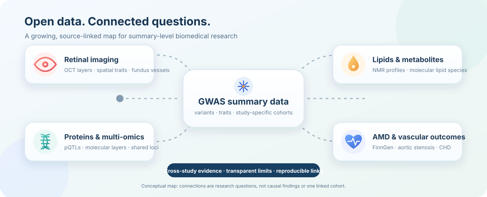

# Public GWAS, metabolomics and oculomics resources

This catalogue points to the source repositories and describes the files currently present in the dedicated RetiSEM causal/MR workspace, plus datasets referenced in its ethics-source notes. It is not a scan of unrelated computer folders or every public dataset worldwide. **It is an index, not a data dump.** The profile repository contains metadata and links only; it does not redistribute the large association files, participant-level records or clinical images.

**Snapshot: 23 November 2026.** “Present locally” means files are in the research workspace, not in this GitHub profile repository. Dataset access, licences and terms are set by each source and should be checked before reuse.

## What is available

| Resource | Local holdings and status | Original source |
| :--- | :--- | :--- |
| **Qiang et al. 2025 — plasma metabolome GWAS** | **313 of 313** listed summary-statistic files are present locally (about **68.4 GB compressed**). This is a broad metabolomics GWAS collection, not participant-level metabolite values. | [Figshare data record](https://doi.org/10.6084/m9.figshare.29390471.v1) · [paper](https://pmc.ncbi.nlm.nih.gov/articles/PMC12449471/) |
| **METSIM — metabolite GWAS** | **Six selected** full summary-statistic files are present: four initial traits plus two lipid traits added for the Han-study follow-up. This is a small selection from the much larger METSIM catalogue, not all 1,391 metabolite traits. | [METSIM PheWeb](https://pheweb.org/metsim-metab/phenotypes) · [paper](https://doi.org/10.1038/s41467-022-29143-5) |
| **GeneRISK — lipidomics GWAS** | **Four selected** full lipid-species GWAS files are present (sterol ester, PC 16:0_22:6, PC 18:0_20:4 and PE 16:0_20:4). The source study includes 179 lipid traits; the other traits were not downloaded. The four data files passed the source-published MD5 checks. | [GWAS Catalog study GCST90277243](https://www.ebi.ac.uk/gwas/studies/GCST90277243) · [GCST90277291](https://www.ebi.ac.uk/gwas/studies/GCST90277291) · [GCST90277304](https://www.ebi.ac.uk/gwas/studies/GCST90277304) · [GCST90277346](https://www.ebi.ac.uk/gwas/studies/GCST90277346) · [study paper](https://doi.org/10.1038/s41467-023-42532-8) |
| **Cadby et al. 2022 — molecular lipid species** | **Two selected** GWAS Catalog summary files are present (GCST90024949 and GCST90025147). They are examples, not a comprehensive lipidome; the second source label includes a neutral-loss annotation and needs careful chemical interpretation. Both files were checked against Catalog-published MD5 values. | [GCST90024949](https://www.ebi.ac.uk/gwas/studies/GCST90024949) · [GCST90025147](https://www.ebi.ac.uk/gwas/studies/GCST90025147) · [paper](https://doi.org/10.1038/s41467-022-30875-7) |
| **Zhao et al. 2023 — circulating protein pQTLs** | **Two selected** full pQTL summary files are present: FGF19 (GCST90274787) and IL-6 (GCST90274815). The data files passed source MD5 checks; metadata sidecar checksum discrepancies are documented locally and should be resolved before harmonisation. | [FGF19, GCST90274787](https://www.ebi.ac.uk/gwas/studies/GCST90274787) · [IL-6, GCST90274815](https://www.ebi.ac.uk/gwas/studies/GCST90274815) · [paper](https://doi.org/10.1038/s41590-023-01588-w) |
| **Zekavat et al. 2024 — OCT retinal layers** | **Nine** retinal-layer GWAS summary files are present. These are population-level associations, not OCT scans or participant records. | [Ocular Knowledge Portal dataset](https://ocular.hugeamp.org/dinspector.html?dataset=Zekavat2021_RetinalLayerThickness_EU) · [paper](https://doi.org/10.1126/scitranslmed.adg4517) |
| **Jackson et al. 2025 — spatial OCT thickness** | **Six** GWAS Catalog files are present (GCST90455721–GCST90455726), corresponding to functional principal components (FPC1–FPC6). They are not six individual retinal layers; the full pixel-level GWAS is available from the authors on request. | [GWAS Catalog accessions](https://www.ebi.ac.uk/gwas/studies/GCST90455721) · [OSF record](https://doi.org/10.17605/OSF.IO/KZUGV) · [paper](https://doi.org/10.1038/s41467-024-55635-7) |
| **Beyeler et al. 2024 — fundus vasculometry** | One **8.8 GB** summary-statistic archive for 17 fundus vessel phenotypes is present and its archive checksum was verified. It has **not been extracted or independently inspected**, so it is not yet labelled analysis-ready. This is not the Jiang et al. dataset. | [Zenodo archive](https://zenodo.org/records/12779552) · [paper](https://doi.org/10.1038/s41467-024-52334-1) |
| **FinnGen R13 — disease outcomes** | Five selected endpoint files are present: CHD (I9_CHD), overall AMD (H7_AMD), dry AMD (DRY_AMD), wet AMD (WET_AMD) and operated aortic stenosis (I9_CAVS_OPERATED). The full release manifest is also local; the other endpoints are candidates, not downloaded GWAS files. | [R13 summary-statistics access](https://www.finngen.fi/en/access_results) · [official R13 manifest](https://storage.googleapis.com/finngen-public-data-r13/summary_stats/finngen_R13_manifest.tsv) · [Risteys endpoint definitions](https://r13.risteys.finngen.fi/) |
| **1000 Genomes Phase 3 — LD reference** | The source archive and EUR PLINK reference files (`.bed/.bim/.fam`) are present locally. This is a genetic-variation reference for exploratory LD clumping, not an ocular/CVD cohort or validation dataset. EUR ancestry is not a perfect proxy for every UK Biobank or Finnish sample; check build, variant coverage and ancestry fit. | [IEU local-LD guide and download](https://mrcieu.github.io/ieugwasr/articles/local_ld.html) · [1000 Genomes data](https://www.internationalgenome.org/data/) |
| **Chen/TARGET 2023 — aortic stenosis** | One complete autosomal GWAS summary file is present locally and passed the source MD5 and full archive integrity checks. It is a different study and phenotype definition from FinnGen operated aortic stenosis; the source meta-analysis includes UK Biobank. | [Zenodo dataset](https://zenodo.org/records/7829401) · [paper](https://doi.org/10.1093/eurheartj/ehad142) |
| **IAMDGC/Fritsche 2016 — advanced AMD** | One public summary file is present. Its columns do **not** include genome-wide beta or SE; the paper's selected-SNP tables do not replace complete regional effect estimates. Treat it as limited association evidence, not a ready MR/colocalisation outcome. | [Original summary file](https://csg.sph.umich.edu/abecasis/public/amd2015/Fritsche_2015_AdvancedAMD.txt.gz) · [study paper](https://doi.org/10.1038/ng.3448) |

## Separate legacy RetiSEM participant-level inputs

The existing [RetiSEM repository data folder](https://github.com/Inamullah-Colab/ReitSEM/tree/main/data) also contains 17 NHANES 2005–2006 XPT source tables, one prepared macular-zone retinal feature table, and a `NHANES_1000G_proxy_only.csv` adjustment table. These files belong to the earlier observational, participant-linked RetiSEM workflow; they are not a GWAS or a linked retinal–lipidomics multi-omics cohort. The workspace documentation flags the retinal feature provenance and `SEQN` linkage for review. The proxy file is not verified participant genotype data and must not be described as genetic instruments for MR. The NHANES source tables are public; access to other derived inputs and their use should follow the project and source terms. [CDC NHANES 2005–2006 data files](https://wwwn.cdc.gov/Nchs/Data/Nhanes/Public/2005/)

## Study materials and important boundaries

### Han et al. — AMD, genetics and metabolomics

The [Cell Reports Medicine paper](https://doi.org/10.1016/j.xcrm.2023.101085) and its supplementary materials are archived locally. The study's complete multi-ethnic, multi-fluid genome-wide association resources and underlying cohort data are **not** all present. The local follow-up adds three FinnGen AMD outcome files and two selected METSIM lipid GWAS; its full UK Biobank, CLSA, NHS/NHSII participant-level datasets are not included. Han's plasma meta-analysis includes METSIM, so the METSIM comparison is not an independent lipid-exposure replication. The Han study reports AMD, while the OCT GWAS describe retinal imaging traits; they are not interchangeable outcomes.

### Zhu et al. — lipidomics, proteins and aortic stenosis

The [European Journal of Medical Research paper](https://doi.org/10.1186/s40001-024-02014-z) and its supplement are archived locally. Although the paper's catalogue covers 179 lipid traits and 91 proteins, the local selection is **four GeneRISK lipid GWAS plus two Zhao pQTL GWAS**. Local outcomes include the Chen/TARGET aortic-stenosis meta-analysis and FinnGen operated aortic stenosis. This is not the paper's full original analysis or a completed joint retinal–lipid–CVD model.

### Retinal vasculometry source not yet acquired

[Jiang et al. 2023](https://doi.org/10.1371/journal.pgen.1010583) is a relevant fundus-vessel GWAS paper, but a public full-summary-statistics file for its exact phenotypes has not been verified or downloaded in this workspace. Its published lead-variant tables should not be treated as complete regional data. Beyeler is a separate fundus study and must not be described as a Jiang replication.

## Resources referenced in ethics notes, not held locally in this inventory

These named resources appear in the workspace's ethics-source notes. Their inclusion there is **not evidence that files are downloaded, access is granted, or their use is covered by ethics approval**.

| Resource | Source and access note |
| :--- | :--- |
| **APTOS 2019** | [Kaggle competition dataset](https://www.kaggle.com/competitions/aptos2019-blindness-detection/data); fundus images and labels, subject to source terms. |
| **DDR / OIA-DDR** | [Dataset repository and download instructions](https://github.com/nkicsl/DDR-dataset) · [paper](https://doi.org/10.1016/j.ins.2019.06.011). |
| **MESSIDOR** | [Official access page](https://www.adcis.net/en/third-party/messidor/). MESSIDOR-2 is a separate release; MAPLES-DR annotates images from original MESSIDOR, so those are not independent cohorts. |
| **EyePACS** | [Kaggle competition release](https://www.kaggle.com/competitions/diabetic-retinopathy-detection/data); it is not automatically the complete EyePACS image collection. |
| **MAPLES-DR** | [Figshare annotations](https://doi.org/10.6084/m9.figshare.24328660) · [documentation](https://github.com/LIV4D/MAPLES-DR). The 198 annotated images are from original MESSIDOR; image access is governed by MESSIDOR terms. |
| **UK Biobank participant-level data** | [Official application information](https://www.ukbiobank.ac.uk/use-our-data/apply-for-access/). Participant-level records and imaging are controlled access and are not present in this public profile or the summary-statistic inventory above. The OCT GWAS listed earlier are published summary data derived from UK Biobank participants. At this snapshot, UK Biobank reports that new applications and UKB-RAP access are paused during platform changes; recheck the provider for updates. |

## What collaborators can and cannot do with summary statistics

Public summary associations can support carefully specified GWAS comparisons, variant harmonisation, instrument-strength checks, summary-data Mendelian randomisation, and colocalisation when suitable full regional statistics, LD information and model assumptions are available. They may also support a summary-level structural model if the method's required inputs, covariance assumptions and diagnostics are met.

Summary-statistic rows are **not** participant-level observations. They cannot be randomly split into train and test sets to claim independent predictive performance, and separate GWAS cannot be joined into a same-person multi-omics table. A credible mediation or pathway claim additionally needs compatible traits, sample-overlap assessment, valid instruments, uncertainty estimates, sensitivity analyses and preferably independent replication. Access to each source and the required analysis permissions must be checked by the contributor.

## Contribute a dataset or correction

Researchers working with GWAS, metabolomics, lipidomics, oculomics, proteomics or other multi-omics summary resources are welcome to suggest additions through a [GitHub issue](https://github.com/Inamullah-Colab/Inamullah-Colab/issues/new) or pull request. Please include:

- study title, paper, DOI and stable dataset accession;
- phenotype(s), omics modality, cohort, ancestry, sample size and case/control counts where applicable;
- genome build, effect-allele convention, effect measure and units or transformation;
- data type and access class (public summary, controlled participant-level, or request-based);
- licence or data-use terms, checksum/provenance and known sample overlap;
- whether the local file is complete, selected, checksum-verified and independently QC-reviewed.

**Please do not attach participant-level records, clinical images, credentials or files whose licence/access terms do not permit redistribution.** Share the source link and accession so collaborators can obtain the files from the data provider.

## Related code

- [RetiSEM framework](https://github.com/Inamullah-Colab/ReitSEM)
- [Profile repository](https://github.com/Inamullah-Colab/Inamullah-Colab)

