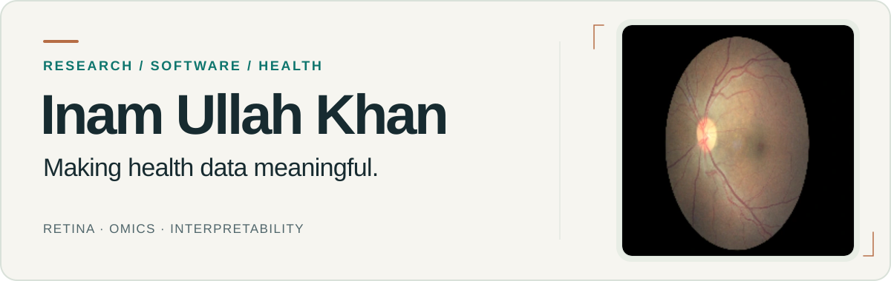

# Archived optional profile sections

These two sections were removed from the main GitHub profile on 22 November 2026 to simplify its layout. The underlying video and research-map assets are retained.

## Restore later

Copy the two `
` blocks below into `README.md`, immediately after the navigation row and before **Selected research & software**. Both files are in the repository root, so the existing `./assets/` paths remain valid. The source revision before this removal is [ffda01c](https://github.com/Inamullah-Colab/Inamullah-Colab/blob/ffda01c80bf63b8238c1018b65975a13afa9da75/README.md).

## Optional sections

<strong>▶ Watch with sound · 56 seconds</strong>

https://github.com/user-attachments/assets/70205de4-335b-4739-84c9-33674c8e3549

<strong>Explore the research map — retina, biomarkers &amp; multi-omics</strong>

<picture>
  <source media="(prefers-color-scheme: dark)" srcset="./assets/profile-header-dark.svg">
  <source media="(prefers-color-scheme: light)" srcset="./assets/profile-header-light.svg">
  
</picture>

Current work spans retinal imaging, lipidomics and clinical data; genomics, wearables, microbiome and other omics are broader integration directions.

## Associated credits and context

The same source attribution remains accessible in the live profile because its animated GIF still uses the retinal imagery and illustrative motion.

<strong>Media credits, chapters &amp; research context</strong>

- **00:00–00:08** — Research profile and background
- **00:08–00:18** — Retinal vasculature, arteries and veins
- **00:18–00:28** — Retina, genomics and lipidomics
- **00:28–00:38** — Systemic health research connections
- **00:38–00:47** — RetinalInsight research software
- **00:47–00:56** — Academic and industry collaboration

Retinal photograph and expert vessel annotations: **Fundus-AVSeg**, Deng et al. (2025), [dataset v2](https://doi.org/10.6084/m9.figshare.27938034.v2), licensed under [CC BY 4.0](https://creativecommons.org/licenses/by/4.0/). Crops, display colours and illustrative motion adapted. This is a public dataset example, not my own retinal image or a prediction from my software. Movement is not measured blood flow; molecular and organ animations are conceptual illustrations.

Music: **Meditation Impromptu 01** by [Kevin MacLeod](https://incompetech.com/music/royalty-free/index.html?isrc=USUAN1100163), licensed under [CC BY 4.0](https://creativecommons.org/licenses/by/4.0/). One continuous excerpt, edited with volume adjustment and fades.

RetinalInsight is a research prototype. The film does not present clinically validated diagnostic outputs.

Real research imagery with illustrative workspace backgrounds: [sources and interpretation](./assets/SOURCES.md).

