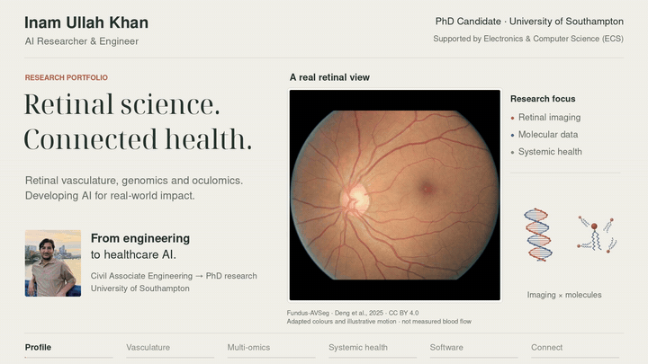
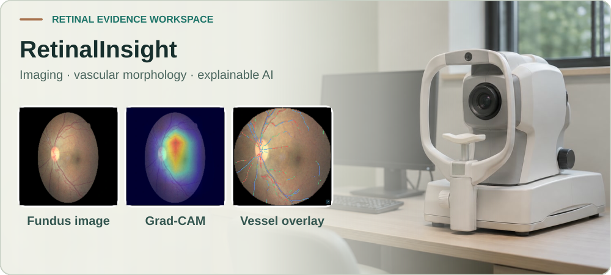

<!-- research-portfolio-animation:start -->

  

<!-- research-portfolio-animation:end -->

   &nbsp; · &nbsp;
  <a href="https://scholar.google.com/citations?user=PRKY9rYAAAAJ"><strong>Google Scholar</strong></a> &nbsp; · &nbsp;
   &nbsp; · &nbsp;
   &nbsp; · &nbsp;
  <a href="https://www.linkedin.com/in/inam-ullah-khan-a30532150/"><strong>LinkedIn</strong></a> &nbsp; · &nbsp;
  <a href="mailto:inamullahk756@gmail.com"><strong>Email</strong></a>

<strong>▶ Watch with sound · 56 seconds</strong>

https://github.com/user-attachments/assets/70205de4-335b-4739-84c9-33674c8e3549

<strong>Explore the research map — retina, biomarkers &amp; multi-omics</strong>

<picture>
  <source media="(prefers-color-scheme: dark)" srcset="./assets/profile-header-dark.svg">
  <source media="(prefers-color-scheme: light)" srcset="./assets/profile-header-light.svg">
  
</picture>

Current work spans retinal imaging, lipidomics and clinical data; genomics, wearables, microbiome and other omics are broader integration directions.

## Selected research &amp; software

<table>
  <tr>
    <td width="50%" valign="top">
      
      <h3>RetinalInsight</h3>
      
RESEARCH PROTOTYPE

      
Inspect diabetic retinopathy predictions alongside vessel morphology, weak lesion cues, Grad-CAM, vascular biomarkers and cited explanations.

      
 &nbsp; 

    </td>
    <td width="50%" valign="top">
      
      <h3>Oculomics × Lipidomics</h3>
      
SCIENTIFIC REPORTS · 2026

      
A Python workflow examining cross-sectional associations between retinal vascular traits and serum lipidomic profiles in a generally healthy biobank population.

      
<a href="https://www.nature.com/articles/s41598-026-74898-2"><strong>Read published paper</strong></a> &nbsp; 

    </td>
  </tr>
  <tr>
    <td width="50%" valign="top">
      
      <h3>RetiSEM</h3>
      
RESEARCH FRAMEWORK · PREPRINT

      
Domain-constrained structural equation modelling for studying retinal and systemic pathways in fragmented biomedical data.

      
<a href="https://arxiv.org/abs/2606.24488"><strong>Read preprint</strong></a> &nbsp; 

    </td>
    <td width="50%" valign="top">
      
      <h3>Interpretable DR Graphs</h3>
      
RESEARCH CODE · PREPRINT

      
Diabetic retinopathy research combining retinal lesion evidence, vessel information, vascular biomarkers and image-level graph structure.

      
<a href="https://doi.org/10.48550/arXiv.2606.24168"><strong>Read preprint</strong></a> &nbsp; 

    </td>
  </tr>
</table>

<strong>Methods, tools &amp; background</strong>

| Area | What I work with |
| :--- | :--- |
| **Machine learning &amp; imaging** | Python · PyTorch · scikit-learn · OpenCV |
| **Data &amp; scientific computing** | pandas · NumPy · SciPy · NetworkX · Matplotlib |
| **Research applications** | FastAPI · Gradio · Hugging Face Transformers · GitHub Pages |
| **Development workflow** | Git · Linux · Jupyter · Colab · documented analysis workflows |

My path into healthcare AI spans civil engineering, physics, mathematics and computer science. I also share educational material and academic opportunities through [Knowledge &amp; Opportunity](https://inamullah-colab.github.io/knowledge/).

<strong>Media credits, chapters &amp; research context</strong>

- **00:00–00:08** — Research profile and background
- **00:08–00:18** — Retinal vasculature, arteries and veins
- **00:18–00:28** — Retina, genomics and lipidomics
- **00:28–00:38** — Systemic health research connections
- **00:38–00:47** — RetinalInsight research software
- **00:47–00:56** — Academic and industry collaboration

Retinal photograph and expert vessel annotations: **Fundus-AVSeg**, Deng et al. (2025), [dataset v2](https://doi.org/10.6084/m9.figshare.27938034.v2), licensed under [CC BY 4.0](https://creativecommons.org/licenses/by/4.0/). Crops, display colours and illustrative motion adapted. This is a public dataset example, not my own retinal image or a prediction from my software. Movement is not measured blood flow; molecular and organ animations are conceptual illustrations.

Music: **Meditation Impromptu 01** by [Kevin MacLeod](https://incompetech.com/music/royalty-free/index.html?isrc=USUAN1100163), licensed under [CC BY 4.0](https://creativecommons.org/licenses/by/4.0/). One continuous excerpt, edited with volume adjustment and fades.

RetinalInsight is a research prototype. The film does not present clinically validated diagnostic outputs.

Real research imagery with illustrative workspace backgrounds: [sources and interpretation](./assets/SOURCES.md).

---

I welcome **academic and industry collaborations** in interpretable AI, medical imaging and biomedical data science.
