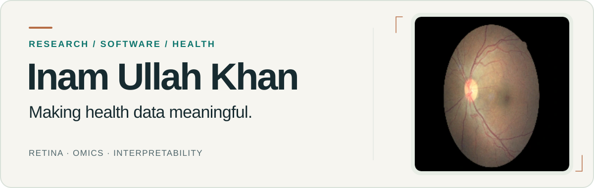
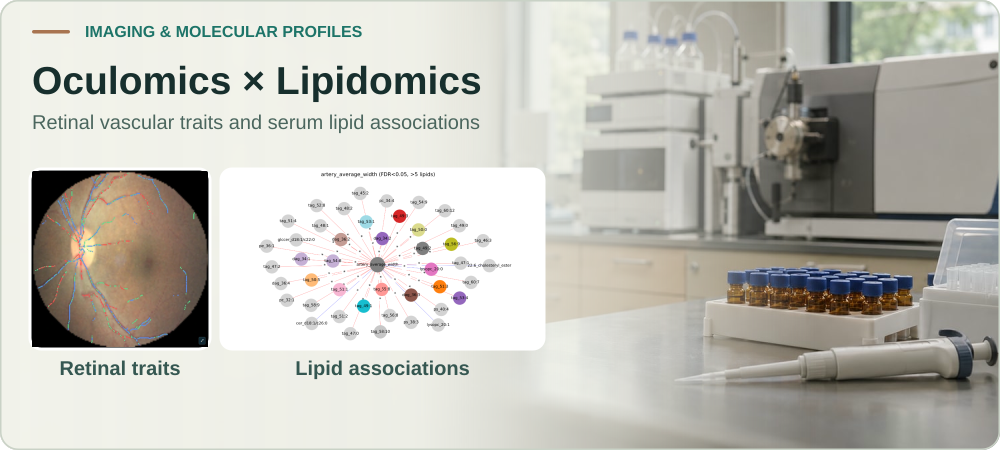
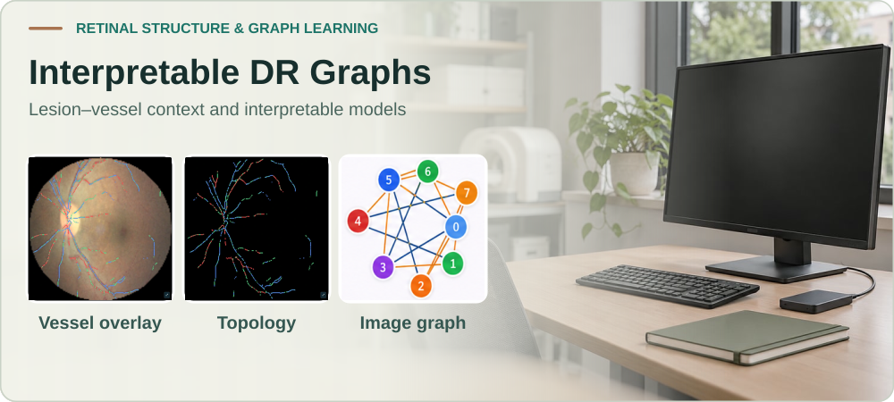

<picture>
  <source media="(prefers-color-scheme: dark)" srcset="./assets/profile-header-dark.svg">
  <source media="(prefers-color-scheme: light)" srcset="./assets/profile-header-light.svg">
  
</picture>

<h3 align="center">AI Researcher &amp; Engineer · PhD Candidate, University of Southampton</h3>

   &nbsp; · &nbsp;
   &nbsp; · &nbsp;
  <a href="https://scholar.google.com/citations?hl=en&amp;user=PRKY9rYAAAAJ"><strong>Google Scholar ↗</strong></a> &nbsp; · &nbsp;
  <a href="https://www.linkedin.com/in/inam-ullah-khan-a30532150/"><strong>LinkedIn ↗</strong></a> &nbsp; · &nbsp;
  <a href="mailto:inamullahk756@gmail.com"><strong>Contact ↗</strong></a>

I develop **interpretable machine learning and statistical methods** that connect retinal imaging with molecular and clinical data. I also build research software that makes model evidence easier to inspect, understand and explore.

<table>
  <tr>
    <td width="33%" valign="top">
      01 / UNDERSTAND 
      <strong>Retina &amp; systemic health</strong> 
      Retinal vasculature, lipidomics and multimodal biomedical data.
    </td>
    <td width="33%" valign="top">
      02 / EXPLAIN 
      <strong>Interpretable models</strong> 
      Image graphs, explainable AI and causal modelling.
    </td>
    <td width="34%" valign="top">
      03 / BUILD 
      <strong>Useful research software</strong> 
      Analysis workflows, evidence dashboards and interactive tools.
    </td>
  </tr>
</table>

## Selected research &amp; software

<table>
  <tr>
    <td width="50%" valign="top">
      
      <h3>RetinalInsight</h3>
      
RESEARCH PROTOTYPE

      
A workspace for inspecting diabetic retinopathy predictions alongside vessel morphology, weak lesion cues, Grad-CAM, vascular biomarkers and cited explanations.

      
<strong>Focus:</strong> evidence inspection · model integration · research interfaces

      
 &nbsp; 

    </td>
    <td width="50%" valign="top">
      
      <h3>Oculomics × Lipidomics</h3>
      
SCIENTIFIC REPORTS · 2026

      
A Python analysis workflow examining cross-sectional associations between retinal vascular traits and serum lipidomic profiles in a generally healthy biobank population.

      
<strong>Focus:</strong> retinal phenotyping · molecular data · statistical analysis

      
<a href="https://www.nature.com/articles/s41598-026-74898-2"><strong>Read published paper ↗</strong></a> &nbsp; 

    </td>
  </tr>
  <tr>
    <td width="50%" valign="top">
      
      <h3>RetiSEM</h3>
      
RESEARCH FRAMEWORK · PREPRINT

      
Domain-constrained structural equation modelling for studying retinal and systemic pathways in fragmented biomedical data.

      
<strong>Focus:</strong> multimodal integration · mediation · structured hypotheses

      
<a href="https://arxiv.org/abs/2606.24488"><strong>Read preprint ↗</strong></a> &nbsp; 

    </td>
    <td width="50%" valign="top">
      
      <h3>Interpretable DR Graphs</h3>
      
RESEARCH CODE · PREPRINT

      
Diabetic retinopathy research combining retinal lesion evidence, vessel information, vascular biomarkers and image-level graph structure.

      
<strong>Focus:</strong> lesion–vessel context · graph learning · interpretability

      
<a href="https://doi.org/10.48550/arXiv.2606.24168"><strong>Read preprint ↗</strong></a> &nbsp; 

    </td>
  </tr>
</table>

## From research questions to working tools

| Area | What I work with |
| :--- | :--- |
| **Machine learning &amp; imaging** | Python · PyTorch · scikit-learn · OpenCV |
| **Data &amp; scientific computing** | pandas · NumPy · SciPy · NetworkX · Matplotlib |
| **Research applications** | FastAPI · Gradio · Hugging Face Transformers · GitHub Pages |
| **Development workflow** | Git · Linux · Jupyter · Colab · documented analysis workflows |

  
<strong>Beyond the code — education, writing &amp; background</strong>

My path into healthcare AI spans civil engineering, physics, mathematics and computer science. I share educational material and academic opportunities through **Knowledge &amp; Opportunity**.

- [Research publications](https://inamullah-colab.github.io/publications/)
- [Curriculum vitae](https://inamullah-colab.github.io/cv/)
- [Knowledge &amp; Opportunity](https://inamullah-colab.github.io/knowledge/)

---

### Let’s connect

I’m interested in **academic and industry research opportunities** and collaborations in interpretable AI, medical imaging and biomedical data science.

**[Explore my portfolio](https://inamullah-colab.github.io/)** · **[Email me](mailto:inamullahk756@gmail.com)** · **[Connect on LinkedIn](https://www.linkedin.com/in/inam-ullah-khan-a30532150/)**

Research software is presented with its project-specific validation status. The visuals above are illustrative; code, methods and references are linked in each project.
